# AI-Based Irrigation Advisory System for Sugarcane
### Operating Systems Mini Project · Use case KJS-AGR-01 · Experiments 4, 6, 7 and 9


| Student | Roll number | Batch |
|---|---|---|
| Param Sangani | 16010424108 | B2 |
| Ankit Vishwakarma | 16010424120 | B2 |
| Aarya Thota | 16010424115 | B2 |

**Project report (PDF):** [`report/OS_UseCase_Report.pdf`](report/OS_UseCase_Report.pdf)

---

## 1. What the project does

Sugarcane farmers in the KIAAR / Godavari Biorefineries command area (North Karnataka) usually decide **when and how much to irrigate** from experience. This leads to water waste and to yield loss from moisture stress.

This project is a **Linux command-line prototype**. It reads soil-moisture sensor data, a 3-day weather forecast and records for 600 farm plots, and predicts each plot's irrigation need with a trained ML model. Then it produces **plot-wise advice for farmers** in English and Hindi, for example:

> *"Irrigate tomorrow morning: run pump 4.0 h (0.5 days of power supply), 44 mm."*
> *"Rainfall of about 33 mm is expected; irrigation is not required."*

The whole workflow is built with Operating Systems concepts. Each of the four experiments is a working part of the application:

| Exp | OS concept | Role in the application | Program |
|:-:|---|---|---|
| **4** | `fork` · `exec` · `wait` · `open/read/write/close` | The **application itself**. A parent process runs every workflow stage as a child process: 2 data-acquisition processes, 5 village prediction processes in parallel, and 1 report process. | `bin/pipeline` |
| **6** | SJF and Round Robin scheduling | The **measured CPU time** of each pipeline process is scheduled with FCFS, SJF, SRTF and RR (q = 2, 5, 10 ms). The program draws Gantt charts and computes average waiting and turnaround times. | `bin/scheduler` |
| **7** | Producer–Consumer (semaphores + mutex) | Sensor-gateway threads stream readings into a bounded buffer that analytics threads consume. `--unsafe` shows the race condition. | `bin/sensor_sync` |
| **9** | Banker's algorithm | Villages compete for shared **pump sets, power slots, canal valves and fertigation units**. Unsafe requests are denied. | `bin/banker` |

## 2. Architecture

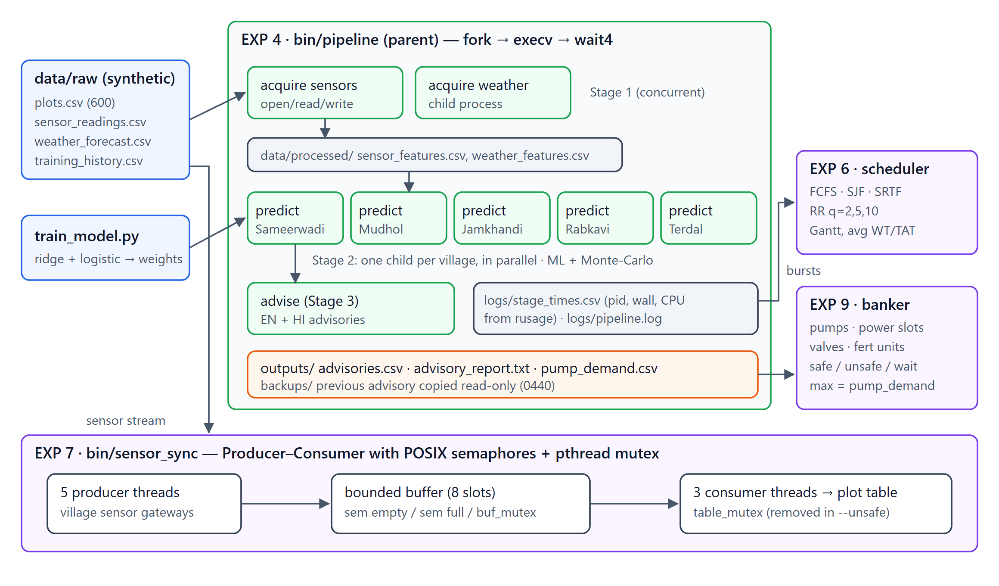

**AI component:** a ridge regression predicts the irrigation depth, and a logistic regression predicts the water-stress probability. Both use agronomic features (FAO-56 crop coefficient, Hargreaves evapotranspiration, soil-water depletion, effective rain). A 4,000-draw Monte-Carlo ensemble gives uncertainty bounds. A rule-based FAO-56 water balance serves as the baseline and as a fallback.

| | ML model | Rule baseline |
|---|---|---|
| Irrigation depth, mean absolute error | **3.51 mm** | 24.93 mm |
| Irrigation depth, R² | **0.986** | 0.430 |
| Water-stress F1 score | 0.857 | 0.855 |

## 3. Screenshots (real runs on Ubuntu 24.04)

### Build
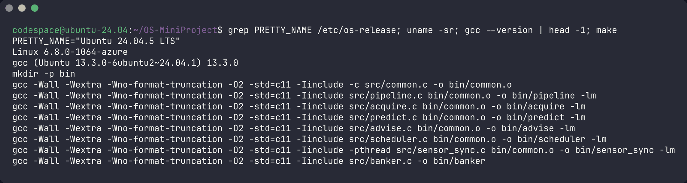

### Experiment 4: the application (fork → exec → wait)
The parent (`pipeline`) forks 8 children in 3 stages. The 5 village predictions run in parallel, and each child is reaped with its exit code and CPU time.

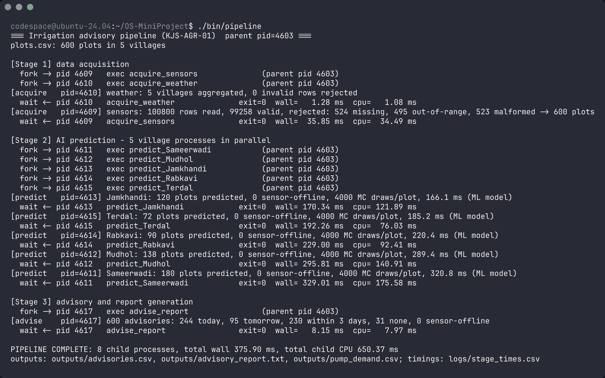

`ps` during a run: every `predict` process has the pipeline as its parent (PPID).

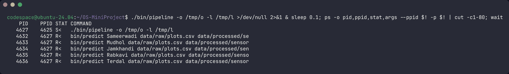

The generated advisory report:

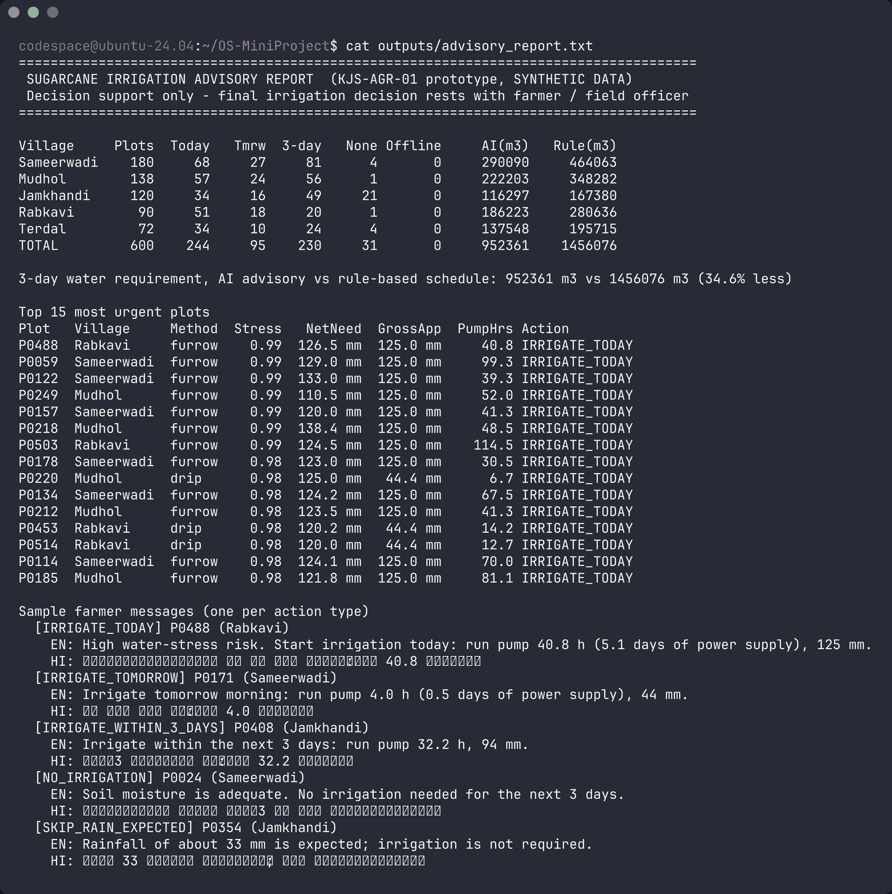

### Experiment 6: SJF and Round Robin on measured burst times
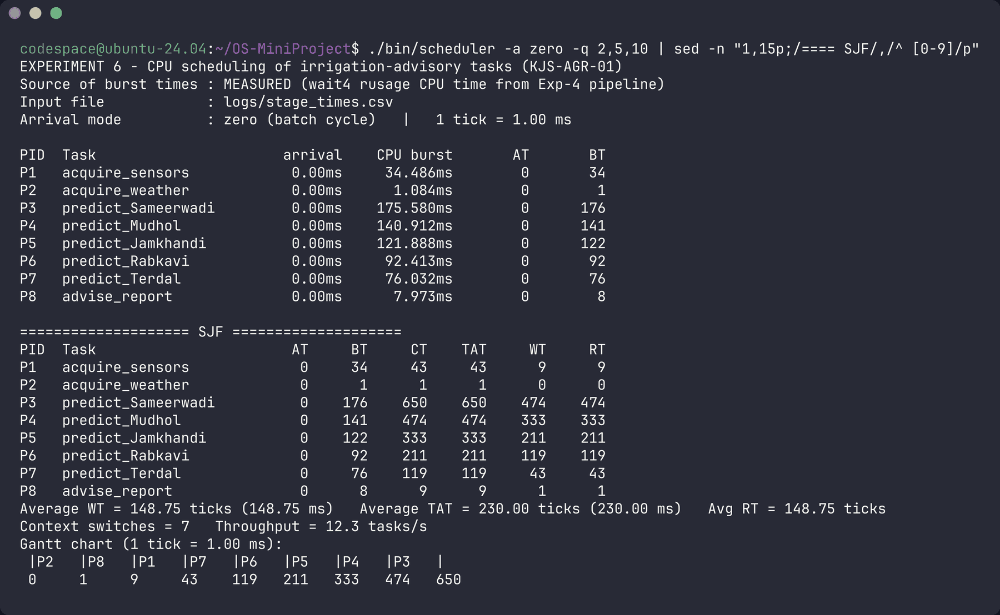
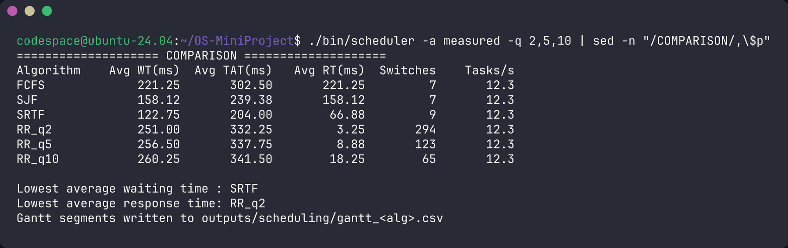

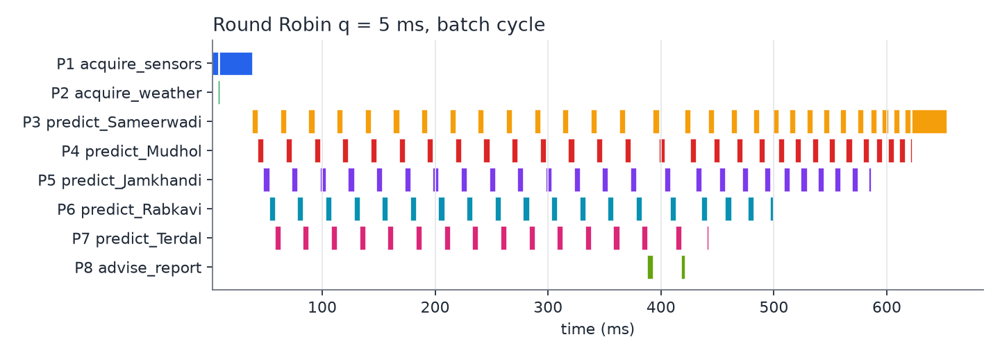 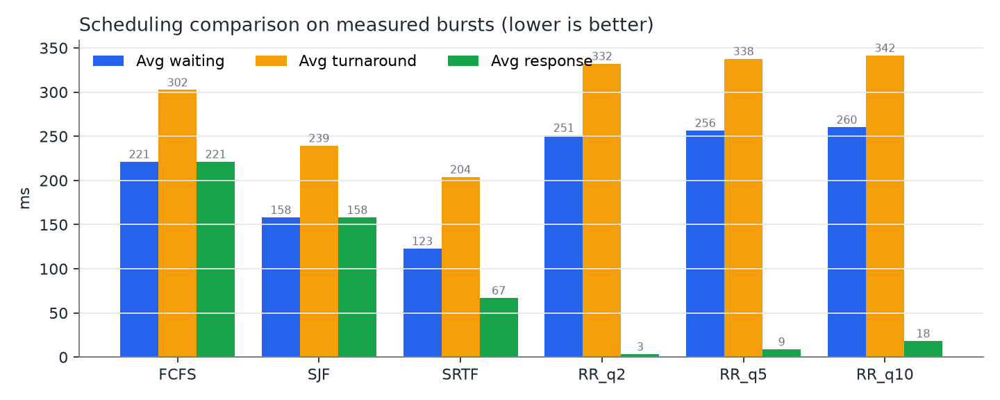

**Result:** SJF cuts the average waiting time of the advisory batch by about 49 % compared with FCFS (148.8 ms vs 289.3 ms). RR with q = 2 ms gives the fastest response time but needs about 300 context switches. → SJF suits the periodic advisory batch, and RR suits interactive requests.

### Experiment 7: Producer–Consumer and race-condition proof
| Safe (semaphores + mutex) | Unsafe (mutex removed) |
|---|---|
| 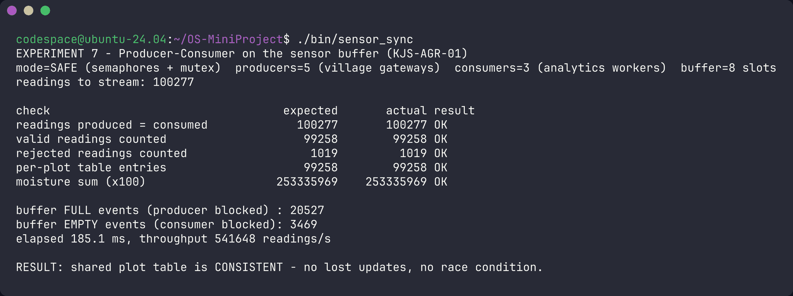 | 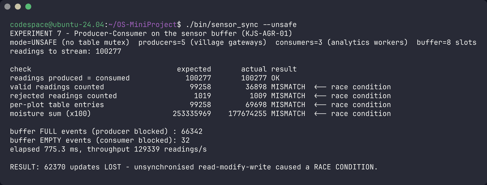 |

Without the mutex, **62,370 updates are lost** to the race condition. With synchronisation, every count matches exactly.

### Experiment 9: Banker's algorithm
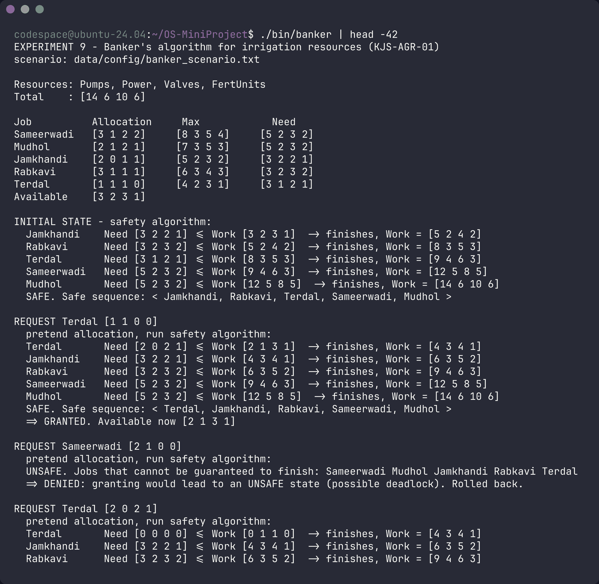
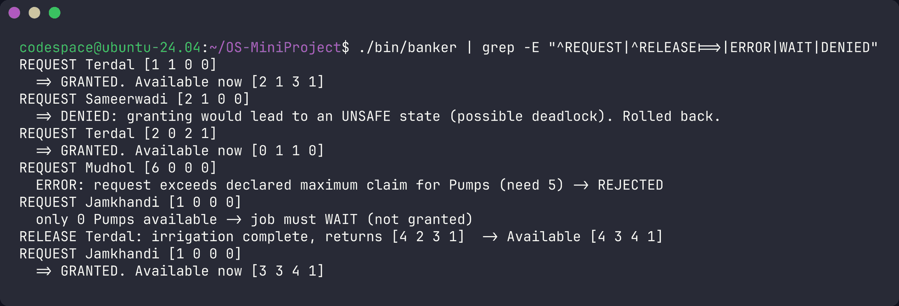

### Tests: normal and failure scenarios
Covers a missing data file, a corrupt file, a missing model, an invalid time quantum, a buffer of size 1, a race condition, and unsafe and invalid resource requests.

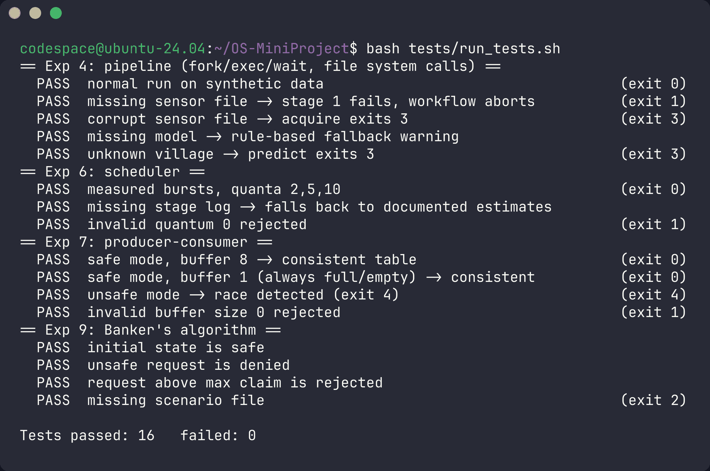

## 4. How to run

**On any Ubuntu / Debian / WSL machine:**
```bash
git clone https://github.com/ParamDesperado/OS-MiniProject-Irrigation-Advisory.git
cd OS-MiniProject-Irrigation-Advisory
make                       # compile all programs into bin/
bash scripts/run_all.sh    # run the application and all four experiments
bash tests/run_tests.sh    # 16 normal + failure-scenario tests
```

**Without a Linux machine:** on this page, click **Code → Codespaces → Create codespace on main**. An Ubuntu terminal opens in the browser with gcc and Python already installed, and the commands above work there.

Run each experiment separately:
```bash
./bin/pipeline                          # Exp 4 – the application
./bin/scheduler -a zero     -q 2,5,10   # Exp 6 – batch cycle (all tasks arrive at t = 0)
./bin/scheduler -a measured -q 2,5,10   # Exp 6 – measured arrival times
./bin/sensor_sync                       # Exp 7 – safe
./bin/sensor_sync --unsafe              # Exp 7 – race condition
./bin/banker                            # Exp 9
```

Requirements (see [`requirements.txt`](requirements.txt)): `gcc`, `make` and `python3` (standard library only), installed with `sudo apt install -y build-essential python3`. `matplotlib` is optional and only redraws the report charts.

## 5. Repository structure

```
├── src/                     C source
│   ├── pipeline.c           Exp 4 – parent process (fork / execv / wait4)
│   ├── acquire.c            Exp 4 – stage 1: validate sensor & weather data
│   ├── predict.c            Exp 4 – stage 2: ML inference + Monte-Carlo, one process per village
│   ├── advise.c             Exp 4 – stage 3: advisories, report, pump demand
│   ├── scheduler.c          Exp 6 – FCFS, SJF, SRTF, Round Robin
│   ├── sensor_sync.c        Exp 7 – producer–consumer (pthreads, semaphores, mutex)
│   ├── banker.c             Exp 9 – Banker's safety + resource-request algorithm
│   └── common.c             shared agronomy, model inference, system-call file I/O
├── include/irrigation.h
├── scripts/
│   ├── generate_data.py     synthetic dataset generator (seed 42)
│   ├── train_model.py       trains the ML models → models/irrigation_model.txt
│   ├── run_all.sh           runs everything
│   ├── make_charts.py       report charts
│   └── capture_screenshots.sh
├── data/raw/                synthetic dataset (600 plots, 100,800 sensor readings)
├── data/config/             Banker's scenario, documented burst-time estimates
├── models/                  trained model weights and evaluation metrics
├── tests/run_tests.sh       automated tests
├── report/                  project report (PDF), figures, raw output logs
└── Makefile
```

## 6. Data and privacy

All data is **synthetic** and generated by `scripts/generate_data.py`: 600 plots in 5 villages (Sameerwadi, Mudhol, Jamkhandi, Rabkavi, Terdal) and 14 days of sensor readings. About 1.5 % of the readings are deliberately faulty (missing, out-of-range or malformed) to exercise validation. Farmer IDs are random anonymised tokens, and no real personal data is used.

*Educational prototype. The advisories are decision support only, and the final irrigation decision stays with the farmer and the field officer.*
